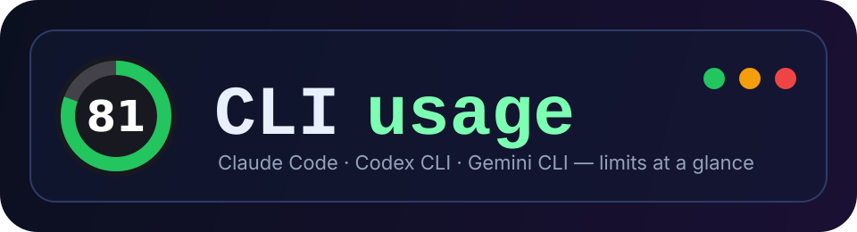
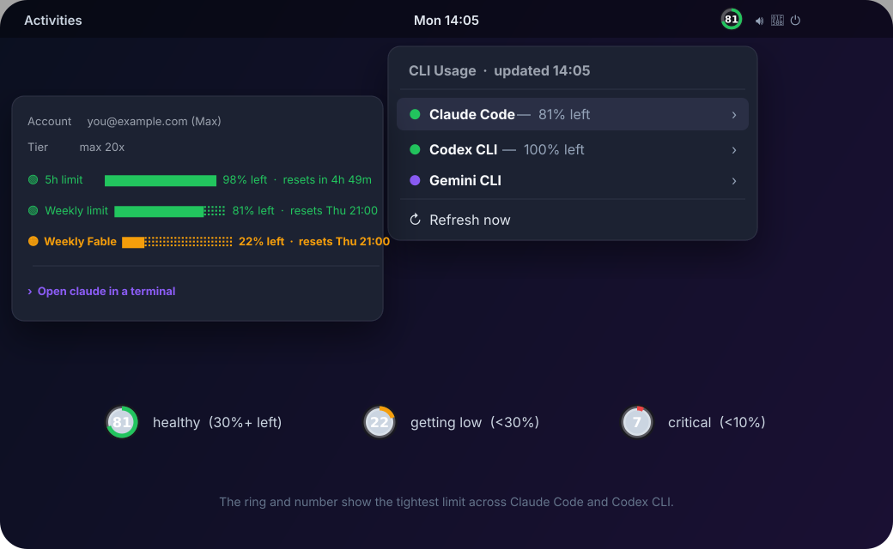

<p align="center">
  
</p>

<p align="center">
  <strong>See your Claude Code, Codex CLI and Gemini CLI limits at a glance, right in your tray or menu bar.</strong>
</p>

<p align="center">
  
  
  
  
</p>

<p align="center">
  
</p>

## Quick start

Paste one command. You don't need git or a manual download.

**Linux and macOS** (in a terminal):

```bash
curl -fsSL https://raw.githubusercontent.com/nimaansari/CLI-Usage/main/install.sh | bash
```

**Windows** (in PowerShell):

```powershell
irm https://raw.githubusercontent.com/nimaansari/CLI-Usage/main/install.ps1 | iex
```

The command:

- installs anything missing: Python on Windows (via winget), the Xcode Command Line Tools on macOS, and the tray libraries on Linux
- puts the app in `~/.local/share/cli-usage` (Windows: `%LOCALAPPDATA%\cli-usage\app`)
- starts the app now and every time you log in

**To update**, run the same command again. It replaces the running copy.

<details>
<summary>Prefer to clone the repo yourself?</summary>

```bash
git clone https://github.com/nimaansari/CLI-Usage.git
cd CLI-Usage
./setup.sh                 # Linux
./setup_macos.sh           # macOS
powershell -ExecutionPolicy Bypass -File .\setup_windows.ps1   # Windows
```

</details>

## What you'll see

**The icon** is a ring showing how much of your tightest limit is left, across Claude Code and Codex CLI.

| Icon | Meaning |
| --- | --- |
| 🟢 green ring | 30% or more left |
| 🟡 amber ring | under 30% left |
| 🔴 red ring | under 10% left |
| `CLI` | still loading, or no limits found |

On macOS the icon is monochrome and follows light and dark mode.

**The menu** has one section per CLI:

```text
CLI Usage  ·  updated 14:05
● Claude Code  —  81% left
    Account    you@example.com (Max)
    🟢  5h limit      ██████████  98% left  ·  resets in 4h 49m
    🟢  Weekly limit  ████████░░  81% left  ·  resets Thu 15 Oct, 20:59
    🟢  Weekly Fable  ██████████  100% left  ·  resets Thu 15 Oct, 21:00
    ›  Open claude in a terminal
● Codex CLI  —  100% left
● Gemini CLI
↻  Refresh now
Quit CLI Usage
```

On Linux each CLI opens as a submenu. On macOS and Windows the rows are listed directly. The data refreshes every minute.

If something needs your attention, the menu says so plainly:

- `⚠ login expired — run claude /login`: run that command.
- `⏳ rate-limited by the provider`: the numbers come back on their own. The last good values stay on screen in the meantime.

## Supported CLIs

| CLI | What it shows |
| --- | --- |
| **Claude Code** | Account and plan, 5-hour limit, weekly limit, and per-model weekly limits (e.g. "Weekly Fable") when your plan has them |
| **Codex CLI** | Account and plan, each limit window labelled by its real length (5h or weekly, depending on the plan), extra limits, credits. With [`ccusage-codex`](https://github.com/ryoppippi/ccusage) installed, it also shows tokens and cost for the month and the latest day. |
| **Gemini CLI** | Account, login type, token expiry, and tokens used today, this month and all-time, read from local session logs. It shows no quota %, because Google has no public quota endpoint for personal logins. |

A CLI you don't have installed is just shown as "not installed".

## Install details

<details>
<summary><strong>Linux</strong></summary>

`./setup.sh` does the following:

1. Installs PyGObject, AyatanaAppIndicator and Pillow if they're missing, using **apt** (Debian, Ubuntu, Mint), **dnf** (Fedora), **pacman** (Arch, Manjaro) or **zypper** (openSUSE).
2. On GNOME, turns on the AppIndicator extension. That's Ubuntu's `ubuntu-appindicators@ubuntu.com` or upstream's `appindicatorsupport@rgcjonas.gmail.com`.
3. Adds **CLI Usage** to autostart (`~/.config/autostart`) and to your app menu.
4. Starts it in the background. You can close the terminal afterwards.

Login sessions often can't see CLIs installed with `nvm`, npm or `~/.local/bin`, so the autostart entry saves the `PATH` of the shell you ran the setup from. If you install a new CLI later, run `./setup.sh` again.

If you don't want system packages installed, use `python3 install.py --frontend xplat` instead. It runs in a local `.venv`.

</details>

<details>
<summary><strong>macOS</strong></summary>

`./setup_macos.sh` builds `~/Applications/CLI Usage.app`. It's a small menu-bar-only app with no Dock icon. A plain Python script would show up as "Python", and macOS may hide that from the menu bar.

It also adds a LaunchAgent, `~/Library/LaunchAgents/com.user.cli-usage.plist`. The LaunchAgent:

- starts the app at login
- restarts it after a crash
- leaves it closed when you pick **Quit**

Claude Code keeps its login in the Keychain. The first time the app reads it, macOS asks whether `security` may access **Claude Code-credentials**. Click **Always Allow**.

</details>

<details>
<summary><strong>Windows</strong></summary>

`setup_windows.ps1` finds Python through the `py` launcher, and skips the Microsoft Store `python` stub. It then:

- installs the dependencies into a local `.venv`
- adds **CLI Usage** to Startup and to the Start menu

The shortcuts run `pythonw.exe`, so no console window opens at login. **Open … in a terminal** opens PowerShell, in Windows Terminal if you have it.

</details>

<details>
<summary><strong>Installer options</strong></summary>

All three setup scripts call `install.py`, which you can also run directly:

```bash
python3 install.py                  # auto-detect everything
python3 install.py --frontend xplat # use the pystray tray (any OS)
python3 install.py --frontend gtk   # use the GTK/AppIndicator tray (Linux)
python3 install.py --no-autostart   # don't start at login
python3 install.py --no-launch      # install, but don't start it now
python3 install.py --skip-deps      # don't install Python packages
python3 install.py --venv PATH      # custom virtualenv location
python3 install.py --dry-run        # show what would happen, change nothing
python3 install.py --uninstall      # stop it and remove it
```

To run it by hand without installing anything:

```bash
python3 cli_usage_gtk.py       # Linux, GTK tray
python3 cli_usage_xplat.py     # any OS, after: pip install -r requirements.txt
```

</details>

## Uninstall

```bash
curl -fsSL https://raw.githubusercontent.com/nimaansari/CLI-Usage/main/install.sh | bash -s -- --uninstall
```

On Windows, or from a cloned folder, run `py -3 install.py --uninstall` (Windows) or `python3 install.py --uninstall` in the app folder.

This stops the app and removes its autostart and menu entries. On macOS it also removes the LaunchAgent and `CLI Usage.app`. Delete the app folder to remove the code too.

## Troubleshooting

Logs are here:

| OS | Log file |
| --- | --- |
| Linux | `~/.local/state/cli-usage/cli-usage.log` |
| macOS | `~/Library/Logs/cli-usage.log` |
| Windows | `%LOCALAPPDATA%\cli-usage\cli-usage.log` |

<details>
<summary><strong>The icon doesn't appear (Linux)</strong></summary>

- Run `./setup.sh` again. It installs and turns on AppIndicator support.
- On GNOME, check that the extension is on: `gnome-extensions list --enabled | grep -i appindicator`
- After installing the extension for the first time, log out and back in.

</details>

<details>
<summary><strong>The icon is a plain "info" or warning symbol (Linux)</strong></summary>

Pillow is missing, so the app falls back to stock icons. Install it, then run `./setup.sh` again:

- Debian/Ubuntu: `sudo apt install python3-pil`
- Fedora: `sudo dnf install python3-pillow`
- Arch: `sudo pacman -S python-pillow`

</details>

<details>
<summary><strong>A CLI shows "not installed" but it is installed</strong></summary>

The app started from a session whose `PATH` doesn't include that CLI. This is common with `nvm` and npm installs. Run the setup command again from a terminal where the CLI works.

</details>

<details>
<summary><strong>The icon doesn't appear (macOS)</strong></summary>

- Check that it's running: `launchctl print gui/$(id -u)/com.user.cli-usage | grep -E "state|pid"`
- Open **System Settings → Menu Bar** and allow **CLI Usage**.
- On a crowded menu bar the icon may be hidden behind the notch. Hold ⌘ and drag it closer to the clock.
- Run `./setup_macos.sh` again to rebuild and restart the app.
- If you clicked **Deny** on the Keychain prompt, run `claude` once, then restart the app.
- The app starts at login, not at boot. With FileVault on, it starts once you log in.

</details>

<details>
<summary><strong>"Python was not found" or the Microsoft Store opens (Windows)</strong></summary>

That's the Store's `python` placeholder. Install real Python, either from [python.org](https://www.python.org/downloads/) (tick **Add python.exe to PATH**) or with `winget install -e --id Python.Python.3.13`. Then open a new PowerShell window and run the setup again.

</details>

<details>
<summary><strong>"usage unavailable"</strong></summary>

- **login expired**: run the command shown in the menu.
- **offline?**: the app couldn't reach the provider. Check your connection.
- **HTTP 4xx/5xx**: the provider changed or blocked its internal usage endpoint. Please open an issue.

</details>

## How it works

The app reads the login each CLI already has on your machine, and asks the same usage endpoints those CLIs use:

| CLI | Login read from | Usage endpoint |
| --- | --- | --- |
| Claude Code | `~/.claude/.credentials.json`, or the macOS Keychain | `api.anthropic.com/api/oauth/usage` |
| Codex CLI | `~/.codex/auth.json` | `chatgpt.com/backend-api/wham/usage` |
| Gemini CLI | `~/.gemini/` (local files only) | none |

`CLAUDE_CONFIG_DIR` and `CODEX_HOME` are respected. Responses are cached for 3 minutes, so a refresh every minute doesn't hammer the providers.

**Privacy:** tokens are only sent to the official endpoints above. They are never stored, logged or sent anywhere else, and there is no analytics. The app can read your CLI login files, so review the code before running it on a machine with sensitive credentials.

## Development

```bash
python3 -m unittest discover -s tests -v
python3 cli_usage_icon.py preview.png     # render all icon states to a PNG
```

```text
cli_usage_core.py    data layer: detection, auth, usage fetch, formatting (no GUI)
cli_usage_icon.py    ring-gauge tray icon (Pillow)
cli_usage_gtk.py     Linux GTK/AppIndicator tray
cli_usage_xplat.py   pystray tray for macOS, Windows and Linux
install.sh / install.ps1   one-line bootstrap installers (download + run setup)
install.py           installer used by all setup scripts
setup.sh / setup_macos.sh / setup_windows.ps1
tests/               unit tests
assets/              logo and preview image
```

## Roadmap

- [ ] Desktop notification when a limit gets low
- [ ] Configurable refresh interval
- [ ] Config file to hide CLIs you don't use
- [ ] Standalone Windows executable
- [ ] Real screenshots from each OS

> This project was vibe coded: built quickly with AI help, practical first, polished enough to ship.

## License

MIT. See [LICENSE](LICENSE).
